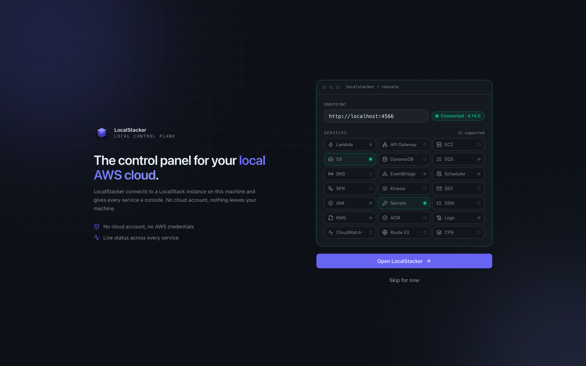

# LocalStacker

A local-first, zero-account desktop GUI for [LocalStack](https://localstack.cloud) —
browse and operate your local AWS resources without reaching for the CLI.

> Community project. **Not affiliated with LocalStack GmbH.**

[](https://github.com/thuanlegit/localstacker/actions/workflows/ci.yml)
[](https://github.com/thuanlegit/localstacker/releases)
[](./LICENSE)
[](https://buymeacoffee.com/ryleth)



LocalStacker delivers a fast, keyboard-driven desktop companion for local AWS development. Operating entirely on your machine, it communicates directly with `localhost:4566` without cloud accounts, telemetry, or external subscriptions.

## Install

Download the latest prebuilt installer from [GitHub Releases](https://github.com/thuanlegit/localstacker/releases/latest):

| Platform | Format | Notes |
|---|---|---|
| **macOS** | `.dmg` | Apple silicon (`aarch64-apple-darwin`) |
| **Windows** | `.exe` | NSIS installer (auto-updates enabled) |
| **Linux** | `.AppImage` | x86_64 binary (auto-updates enabled) |

LocalStacker includes a built-in auto-updater that notifies you when a new release is available and handles update installation and relaunch in one click.

## Features

| Service | Capabilities |
|---|---|
| **S3** | Folder-style browsing with object previews, drag & drop uploads, downloads, presigned URL generation |
| **SQS** | Real-time queue depth & in-flight metrics, send validated JSON messages, **peek messages without consuming**, purge, dead-letter queue redrive |
| **Secrets Manager** | List secrets, create and update secrets, reveal decrypted secret values, delete secrets (explains LocalStack Hobby+ auth token requirements) |
| **Lambda** | Function listing, configuration inspection (runtime, handler, env vars), **invoke with test payload → response status + payload + logs (LogType=Tail)**, edit environment variables |
| **DynamoDB** | Tables list, key schema (`HASH`/`RANGE`), GSIs/LSIs, virtualized item grid, Scan & Query (PK/SK expressions), JSON item editor, delete item, clear table |
| **SNS** | Topics list (standard & FIFO), attributes, subscriptions list, publish message (payload + attributes), subscribe SQS queue helper |
| **CloudWatch Logs** | Log groups & streams exploration, virtualized log viewer with live tailing & search filter, deep-link from Lambda function view |
| **SSM Parameter Store** | Parameters in path hierarchy and flat views, type badges (`String`, `StringList`, `SecureString`), decrypted value toggle, create/update/delete |
| **EventBridge** | Event buses (default & custom), rules explorer with event pattern viewer/editor, target management (Lambda, SQS, SNS), rule enable/disable, PutEvents test event publisher |
| **EventBridge Scheduler** | Schedule groups, schedules list (rate/cron/at) with enable/disable toggles, create/delete schedules, target & payload inspector |
| **API Gateway** | REST APIs listing, resource tree, method inspector, stage deployments, **built-in Method Test Runner** (`TestInvokeMethod`) |
| **SES** | Verified email & domain identities, send test email modal, **LocalStack Captured Mailbox** with HTML, plaintext, raw MIME, and attachment tabs |
| **IAM** | Roles, users, and policies listing, trust relationship policy inspector, inline policy editor with syntax-highlighted JSON viewer, user access keys manager (.env copy helper) |
| **Route 53** | Hosted zones explorer (public/private), virtualized ResourceRecordSets grid (@tanstack/react-virtual), DNS records editor (A, AAAA, CNAME, TXT, MX, etc.) with TTL & value validation |
| **EC2** | Instances list with mock state transitions (Start, Stop, Reboot, Terminate), Key Pairs manager (create with .pem download, delete), Security Groups list with visual Inbound/Outbound rule matrix visualizer, Authorize/Revoke ingress & egress rules |
| **Docker** | Container lifecycle management via local Docker socket (`bollard`): detect/inspect LocalStack containers (including `localstack-persist`), start/stop/restart/remove with persistence-aware warnings, real-time snapshot + follow logs console, launch wizard with visual service picker (`SERVICES`), image pull progress & auto-connect |
| **Step Functions** | State machine list, ASL definition viewer, execution runner with event history timeline, visual state graph (`react-flow`) |
| **DynamoDB Streams** | Enable/disable table streams with view selection, shard explorer with **record peek (no consumption)**, decoded New/Old image JSON viewer |
| **Kinesis** | Data streams list with create wizard, shard map, **record peek via TRIM_HORIZON iterator**, test record publisher (PutRecord), enhanced consumers (EFO) list |
| **CloudWatch** | Custom metric browser (namespace/dimension filter) with inline statistics viewer, PutMetricData test publisher, threshold alarm create/delete with state badges & detail drawer, STS caller identity chip on Home |
| **KMS** | Symmetric key list with create & scheduled deletion, key detail view with aliases management, **encrypt/decrypt playground** (plaintext ↔ base64), key policy viewer, rotation status |
| **ACM** | Certificate inventory with status badges, DNS-validated certificate requests with **CNAME validation token display**, PEM certificate import, inline detail drawer (subject, issuer, validity, SANs) |
| **CloudFormation** | Stack inventory with status badges, stack inspector (outputs, resources, **event timeline**, template viewer), delete stack; Route 53 Resolver endpoints & rules sections |

## Development

Prerequisites: Node 22+, pnpm, Rust toolchain, Docker.

```sh
pnpm install
pnpm tauri dev
```

Point LocalStacker at a running LocalStack container:

```sh
docker run --rm -p 4566:4566 -v /var/run/docker.sock:/var/run/docker.sock localstack/localstack:4.14.0
```

> **Why LocalStack 4.14.0?**
> LocalStack 4.14.0 is pinned as the community release operating without mandatory auth tokens across core services. Mounting `/var/run/docker.sock` is required by LocalStack to execute Lambda function runtimes.

### Scripts

| Command | Purpose |
|---|---|
| `pnpm tauri dev` | Run desktop app with hot reload |
| `pnpm tauri build` | Build release installers locally |
| `pnpm dev` | Run frontend in browser dev mode |
| `pnpm typecheck` | Run TypeScript type checking (`tsc --noEmit`) |
| `pnpm test` | Run Vitest unit tests |
| `pnpm test:watch` | Run Vitest in watch mode |
| `pnpm e2e` | Run Playwright end-to-end test suite against LocalStack |
| `pnpm e2e:headed` | Run Playwright tests in headed browser mode |
| `pnpm screenshots` | Regenerate documentation screenshots |

### Releasing

1. Ensure working directory is clean on `main`.
2. Bump versions across `package.json`, `src-tauri/tauri.conf.json`, and `src-tauri/Cargo.toml`.
3. Verify test suites: `pnpm typecheck && pnpm test && pnpm e2e`.
4. Commit: `git commit -m "chore(release): vX.Y.Z"`.
5. Tag: `git tag -a vX.Y.Z -m "LocalStacker vX.Y.Z"`.
6. Push commit and tag: `git push origin main --tags`.
7. The GitHub Actions release workflow builds the cross-platform matrix, signs updater artifacts, and creates a draft release on GitHub. Review and publish the release.

#### Required Repository Secrets
- `TAURI_SIGNING_PRIVATE_KEY`: Private minisign key generated via `pnpm tauri signer generate`.
- `TAURI_SIGNING_PRIVATE_KEY_PASSWORD`: Passphrase protecting the private signing key.
- `APPLE_*` (optional): Set `APPLE_CERTIFICATE`, `APPLE_CERTIFICATE_PASSWORD`, `APPLE_ID`, `APPLE_PASSWORD`, `APPLE_TEAM_ID` when an Apple Developer account is configured for notarization. If omitted, the workflow cleanly skips notarization and produces unsigned DMGs.

## Stack

Tauri 2 · React 19 · TypeScript · Tailwind CSS v4 · shadcn/ui · TanStack Query · TanStack Virtual · Zustand · AWS SDK v3 · Playwright · Vitest + Testing Library

## Support

LocalStacker is free and open source (AGPL-3.0) — free for everyone, including commercial use. If it saves you time, consider:

[](https://buymeacoffee.com/ryleth)

## License

Licensed under the [GNU Affero General Public License v3.0](./LICENSE) (AGPL-3.0-only) — free to use, study, modify, and redistribute, **including for commercial purposes**, under copyleft terms: derivatives and network-offered services must ship their source under AGPL-3.0. Projects that cannot accept copyleft terms can arrange an alternative commercial license — reach out via [Buy Me a Coffee](https://buymeacoffee.com/ryleth) or [open an issue](https://github.com/thuanlegit/localstacker/issues).

Third-party dependencies keep their own licenses (MIT, Apache-2.0, etc.) — see each dependency's repository. Contributions are accepted under AGPL-3.0-only (inbound = outbound), keeping dual licensing available as sole copyright holder.
